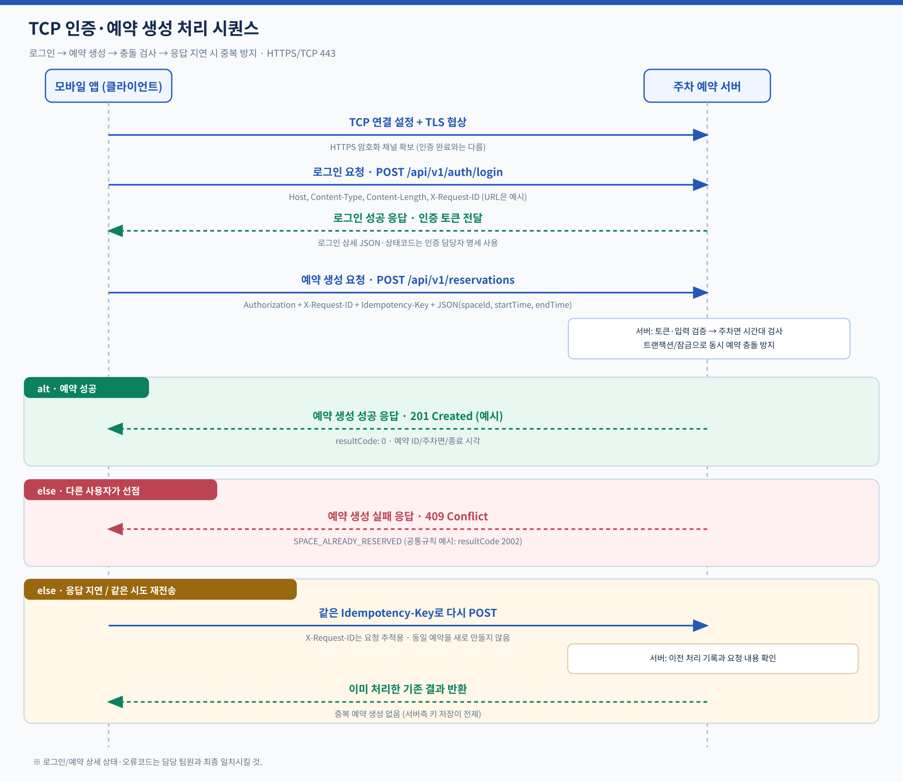

# TCP 사용 근거 및 인증·예약 요청/응답 절차

담당: 장성준 / 설계 범위: **모바일 앱 ↔ 주차 예약 서버 통신**.

> 기획서 5페이지에 지정된 '회원 가입, 로그인, 예약 기능에 TCP를 사용하는 근거와 요청·응답 절차'에 해당한다. 단, 실제 **인증·예약 생성 메시지의 상세 JSON 필드와 결과 코드 최종 결정은 해당 기능 담당자** 의 문서를 따라야 한다. 이 문서의 `POST /api/v1/auth/login`, 로그인 HTTP 상태 및 예약 성공 `201 Created`는 절차 설명을 위한 **예시**로서 담당자와 대조해야 한다.

## 1. 왜 TCP를 사용하는가?

| 비교 항목 | TCP | UDP | 주차 예약에서의 판단 |
|---|---|---|---|
| 전달 신뢰성 | 손실 데이터 재전송 및 전송 순서 관리 | 기본 재전송·순서 보장 없음 | 예약·취소 등 중요한 요청과 응답에는 TCP가 적합 |
| 연결 방식 | 연결 지향 | 비연결형 | 인증 후 요청과 응답을 안정적으로 교환 |
| 데이터 순서 | 바이트 스트림 순서 보장 | 데이터그램 도착 순서 보장 안 함 | 연속된 요청을 다루기 편리하나, **서버 작업 순서까지 자동 보장하는 것은 아님** |
| 추가 비용 | 연결 설정, 확인 응답 등의 오버헤드 | 비교적 작은 헤더·오버헤드 | 예약 정확성이 약간의 지연보다 중요 |
| 팀 설계 | **HTTPS/HTTP/1.1 (TCP 443)** | 주차 현황 빠른 갱신 보조 채널 (UDP 50000) | 인증·예약은 TCP, 공개 현황 갱신만 UDP 보조 사용 |

**선택 근거:** 예약 정보 유실·잘못된 순서·인증 정보 노출을 줄이기 위해 인증과 예약 생성에 HTTPS/TCP를 선택했다. TLS는 전송 데이터를 암호화한다. 다만 **TCP만으로 '같은 주차면의 중복 배정'이나 '예약 버튼 연타에 따른 중복 생성'을 막을 수는 없다.** 이 문제는 서버의 동시성 제어와 `Idempotency-Key` 처리가 별도로 필요하다.

## 2. HTTP와 TCP의 역할 구분

```text
모바일 앱 JSON 본문
  ↓ HTTP/1.1 요청줄 + HTTP 헤더 (예: Authorization, X-Request-ID)
  ↓ TLS 암호화 (HTTPS)
  ↓ TCP 헤더 (포트·시퀀스 번호·확인 응답: 운영체제가 처리)
  ↓ IP 패킷
주차 예약 서버
```

- HTTP는 요청 메서드, URL, 응답 상태, 본문 형태를 구분한다.
- TLS는 전송 데이터를 암호화한다.
- TCP는 데이터를 순서에 맞게 전달하고 손실 시 재전송을 처리한다.
- JSON 본문의 종료는 팀 규칙에 따라 HTTP `Content-Length`(UTF-8 바이트 수)로 판단한다.
- 앱이 TCP `Sequence Number`나 `Acknowledgment Number`를 JSON 필드로 직접 만드는 것은 아니다.

## 3. 인증(로그인) 요청/응답 절차

1. 앱이 서버 `parking-reservation.example.com:443`에 TCP 연결을 설정하고 TLS 협상을 수행한다.
2. 앱이 **HTTPS 로그인 요청**을 전송한다. 예시 경로는 `POST /api/v1/auth/login`이다(인증 담당자와 최종 확인 필요).
3. 로그인 요청에는 팀 공통규칙에 따라 `Host`, `Content-Type`, `Content-Length`, `X-Request-ID`를 포함한다. 로그인 요청에는 아직 `Authorization`과 `Idempotency-Key`를 넣지 않는다.
4. 서버가 사용자 인증정보를 검사한다.
5. 로그인 성공 시 서버가 응답으로 **인증 토큰**을 전달한다. 토큰 데이터 구조·실패 상태 등은 인증 담당자의 명세를 따른다.
6. 앱은 이후 예약 생성·조회 요청의 `Authorization: Bearer <토큰>` 헤더로 인증 상태를 증명한다.

**핵심:** 로그인 성공은 HTTP 응답으로 확인한다. TCP 연결이 성공했다고 자동으로 로그인이 된 것은 아니다.

## 4. 예약 생성 요청/응답 절차

팀 공통규칙에 실린 예약 생성 요청을 기준으로 정리한다.

```http
POST /api/v1/reservations HTTP/1.1
Host: parking-reservation.example.com
Authorization: Bearer <LOGIN_ACCESS_TOKEN>
Content-Type: application/json
Content-Length: <JSON_UTF8_BYTE_LENGTH>
X-Request-ID: 550e8400-e29b-41d4-a716-446655440000
Idempotency-Key: 7f3a9d21-8b23-4dc4-a106-fd735fa38b11

{
  "spaceId": "A-101",
  "startTime": "2026-12-01T10:00:00Z",
  "endTime": "2026-12-01T12:00:00Z"
}
```

1. 앱이 주차면과 예약 사용 시작·종료 시각을 입력받는다.
2. 앱이 **하나의 예약 시도에 하나의 `Idempotency-Key`**(UUID)를 생성하고 POST 요청을 HTTPS로 전송한다.
3. 서버가 토큰, 요청값 형식, 해당 시각의 주차면 예약 가능 여부를 검증한다.
4. 서버가 **원자적 처리(트랜잭션/잠금/시간 겹침 방지 제약 등)**로 동일 주차면의 겹치는 예약을 차단한다. 단순히 조회 후 INSERT하는 방식만으로는 경쟁 상황을 막을 수 없다.
5. 예약 성공 시 서버는 예약 ID, 주차면, 확정된 예약 시간 정보를 반환한다. 예시 HTTP 상태는 `201 Created`, `resultCode: 0`이다(생성 담당자의 최종 표에 맞춤).
6. 이미 다른 사용자가 같은 시간대에 예약했다면 서버는 충돌 응답을 보낸다. 팀 공통규칙의 **예시**는 `409 Conflict`, `resultCode: 2002`, `SPACE_ALREADY_RESERVED`이다. 실제 사용 번호는 예약 생성 담당자와 협의한다.
7. 앱은 실패 시 최신 주차 현황을 다시 조회하도록 안내하고 다른 주차면 선택을 유도한다.

## 5. 지연·중복 요청을 처리하는 방법

- **버튼을 여러 번 누름 / 응답을 받지 못함:** 같은 예약 시도를 재시도할 때는 **같은** `Idempotency-Key`를 사용한다. 서버는 키와 사용자·요청내용을 대조하여 이미 처리한 경우 신규 예약을 만들지 않고 기존 결과를 재전달하도록 설계한다.
- **사용자가 새로운 예약을 시도함:** 새로운 키를 발급한다. 서로 다른 예약 시도까지 하나로 묶으면 안 된다.
- **동시에 서로 다른 고객이 한 주차면을 예약함:** 서버가 같은 주차면·겹치는 시간 범위를 원자적으로 검사하고, 한쪽만 성공시킨다. 나머지 사용자에게 충돌 오류를 반환한다.
- **`X-Request-ID`와의 차이:** `X-Request-ID`는 개별 HTTP 요청과 로그를 추적하는 ID이다. 반면 `Idempotency-Key`는 중복 실행 방지용 ID이므로 둘을 혼동하면 안 된다. 다시 보낸 HTTP 요청은 새 `X-Request-ID`를 사용할 수 있지만 기존 예약 시도의 `Idempotency-Key`를 유지해야 한다.
- **서버 실패:** TCP의 재전송 기능만으로 서버가 이미 저장한 예약의 존재 여부를 판단할 수 없다. 서버 측 중복 키 기록 및 트랜잭션 관리가 필요하다.

## 6. 인증·예약 생성 시퀀스 다이어그램




## 8. 참고 자료

- 팀 제공 자료: `공통규칙.md`, `학습내용.md`, `네트워크프로토콜 PBL 기획서 A조`.
- HTTP 메서드와 상태 코드: [RFC 9110: HTTP Semantics](https://www.rfc-editor.org/rfc/rfc9110.html).
