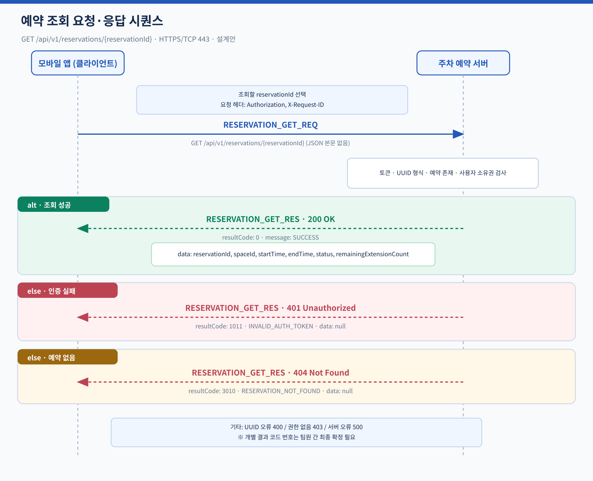

# 예약 조회 메시지 정의표

담당: 장성준 / 기능: **예약 조회** / 기준: 팀의 `공통규칙.md`, `학습내용.md`.

> **팀 검토 전 설계안**: 이 문서의 `GET /api/v1/reservations/{reservationId}` 경로, 조회 응답의 세부 필드와 아래 결과 코드 번호는 담당자가 제안한 값이다. 팀 공통규칙에 이미 확정된 HTTP/JSON 형식과 구분한다. 특히 예약 생성·변경·취소 담당 팀원과 필드명 및 코드 중복 여부를 확인해야 한다.

## 1. 기본 통신 규격

| 항목 | 규칙 |
|---|---|
| 메시지 이름 | `RESERVATION_GET_REQ` / `RESERVATION_GET_RES` (문서에서 사용하는 논리적 이름) |
| 전송 계층 | TCP |
| 응용 계층 | HTTP/1.1 over TLS (**HTTPS**) |
| 서버 | `parking-reservation.example.com:443` |
| HTTP 메서드 | `GET` |
| API 엔드포인트 | `/api/v1/reservations/{reservationId}` (**제안**) |
| 문자 인코딩 | UTF-8 |
| 응답 본문 | JSON, 최대 16,384바이트 |
| 길이 구분 | JSON 응답의 `Content-Length`는 UTF-8 **바이트** 단위 |
| 요청 JSON 본문 | **없음**. 조회 대상은 URL 경로의 `reservationId`로 전달 |

`GET`은 자원 정보를 읽는 메서드이므로 이 설계에서는 JSON 요청 본문을 사용하지 않는다. 단순 조회에는 팀 규칙에 따라 `Idempotency-Key`도 넣지 않는다. `RESERVATION_GET_REQ`와 `RESERVATION_GET_RES`는 문서에서 편의상 붙인 명칭이며 별도 HTTP 헤더 `X-Message-Type`은 사용하지 않는다.

## 2. RESERVATION_GET_REQ — 예약 조회 요청

HTTP 요청 시작줄:

```http
GET /api/v1/reservations/b9315270-1754-47b6-bb47-a1fd3888ff29 HTTP/1.1
```

| 필드명 | 자료형 / 최대 크기 | 위치·설명 |
|---|---|---|
| `Host` | 문자열 / 최대 253바이트 | HTTP 헤더. `parking-reservation.example.com` (예시 값은 31바이트) |
| `Authorization` | 문자열 / 최대 2,048바이트 | HTTP 헤더. `Bearer `와 로그인 때 발급된 토큰. 서버에서 사용자 인증 |
| `X-Request-ID` | UUID 문자열 / 36바이트 | HTTP 헤더. 요청 식별 및 서버 로그 추적 |
| `reservationId` | UUID 문자열 / 36바이트 | **URL 경로 변수**. 조회할 예약의 식별자. JSON 본문에 중복해서 넣지 않음 |

**실제 HTTP 요청 형식 예시** (토큰은 설명을 위한 가상 값):

```http
GET /api/v1/reservations/b9315270-1754-47b6-bb47-a1fd3888ff29 HTTP/1.1
Host: parking-reservation.example.com
Authorization: Bearer <LOGIN_ACCESS_TOKEN>
X-Request-ID: 550e8400-e29b-41d4-a716-446655440000
```

- 조회 요청은 JSON 본문이 없으므로 이 설계에서는 `Content-Type`과 `Content-Length`를 보내지 않는다.
- `Idempotency-Key`는 예약 **생성·변경·취소·연장**에서만 사용한다.
- `reservationId`가 UUID 형식을 지키는지 서버가 확인하고, 인증된 사용자의 예약인지 검사한다.

## 3. RESERVATION_GET_RES — 조회 성공 응답

HTTP 응답 시작줄: `HTTP/1.1 200 OK`

| 필드명 | 자료형 / 최대 크기 | 위치·설명 |
|---|---|---|
| `Content-Type` | 문자열 / 16바이트 | 응답 헤더. `application/json` |
| `Content-Length` | 10진수 문자열 / 최대 5바이트 | 응답 헤더. 아래 JSON 본문의 UTF-8 바이트 길이 |
| `X-Request-ID` | UUID 문자열 / 36바이트 | 응답 헤더. 요청의 값을 그대로 반환 |
| `resultCode` | JSON 정수 / `0`은 UTF-8 표현 1바이트 | 응답 JSON. 성공이면 항상 `0` |
| `message` | 문자열 / `SUCCESS`는 7바이트 | 응답 JSON. 성공 메시지 `SUCCESS` |
| `data` | JSON 객체 / 전체 본문 제한 이내 | 조회 결과를 담는 객체 |
| `data.reservationId` | UUID 문자열 / 36바이트 | 조회된 예약 ID |
| `data.spaceId` | 문자열 / 최대 32바이트 (**제안**) | 배정된 주차면 식별자, 예: `A-101` |
| `data.startTime` | UTC 시각 문자열 / 20바이트 | 예약 사용 시작 시각, `YYYY-MM-DDTHH:mm:ssZ` |
| `data.endTime` | UTC 시각 문자열 / 20바이트 | 현재 확정된 예약 사용 종료 시각 (연장 성공 시 변경된 값) |
| `data.status` | 대문자 영문 문자열 / 최대 16바이트 (**제안**) | 예약 상태. 예: `RESERVED` |
| `data.remainingExtensionCount` | JSON 정수 / 0~2는 1바이트 | 추가 연장 가능한 남은 횟수. 팀 규칙의 최대 2회 반영 |

`endTime`은 **주차 사용 종료 시각**으로 정의한다. 발주 문서에 나온 '예약 만료 시간'이 '입차 유효기간'처럼 별도의 시간 개념이라면 `endTime`과 구분되는 새 필드의 필요성을 팀에서 결정해야 한다. 현재 설계에는 별도 만료 필드를 임의로 넣지 않았다.

**조회 성공 JSON 예시 — HTTP 200 OK**

```json
{
  "resultCode": 0,
  "message": "SUCCESS",
  "data": {
    "reservationId": "b9315270-1754-47b6-bb47-a1fd3888ff29",
    "spaceId": "A-101",
    "startTime": "2026-12-01T10:00:00Z",
    "endTime": "2026-12-01T12:00:00Z",
    "status": "RESERVED",
    "remainingExtensionCount": 2
  }
}
```

`status`의 상태명은 **임시 제안**이다. 현재 예시는 `RESERVED`만 사용하며 변경·취소 담당 팀원이 정의한 나머지 상태명과 반드시 맞춰야 한다.

## 4. RESERVATION_GET_RES — 조회 실패 응답

**공통 실패 필드 정의표**

| 필드명 | 자료형 / 최대 크기 | 설명 |
|---|---|---|
| `Content-Type` | 문자열 / 16바이트 | HTTP 응답 헤더. `application/json` |
| `Content-Length` | 10진수 문자열 / 최대 5바이트 | HTTP 응답 헤더. JSON 본문의 UTF-8 바이트 수 |
| `X-Request-ID` | UUID 문자열 / 36바이트 | HTTP 응답 헤더. 요청값을 그대로 반환 |
| `resultCode` | JSON 정수 / 오류 번호는 4자리 ASCII 표현 | 응답 JSON. 실패 원인을 표시하는 네 자리 숫자 |
| `message` | 대문자 영문 문자열 / 최대 32바이트 | 응답 JSON. 오류를 식별하는 이름 |
| `data` | JSON `null` / 4바이트 | 응답 JSON. 실패 시 데이터 없음 |

**예약이 없는 경우 — HTTP 404 Not Found**

```json
{
  "resultCode": 3010,
  "message": "RESERVATION_NOT_FOUND",
  "data": null
}
```

**인증 토큰이 없거나 유효하지 않은 경우 — HTTP 401 Unauthorized**

```json
{
  "resultCode": 1011,
  "message": "INVALID_AUTH_TOKEN",
  "data": null
}
```

**해당 사용자 소유의 예약이 아닌 경우 — HTTP 403 Forbidden**

```json
{
  "resultCode": 3011,
  "message": "RESERVATION_FORBIDDEN",
  "data": null
}
```

나머지 오류(`400`, `500`)의 정의 및 메시지 예시는 [예약조회_결과코드표.md](예약조회_결과코드표.md)에 포함한다. 위 번호들은 팀 전체 코드 번호 배정이 확정되기 전의 **제안 번호**이다.

## 5. 조회 처리 절차

1. 사용자가 앱에서 본인의 예약을 선택한다.
2. 앱이 저장하고 있던 예약 ID로 URL 경로를 구성하고, 로그인 토큰과 `X-Request-ID`를 넣어 HTTPS `GET` 요청을 전송한다.
3. 서버가 토큰, UUID 형식, 예약 존재 여부 및 사용자 접근 권한을 확인한다.
4. 정상 조회라면 서버가 예약 ID, 배정 주차면, 시작·종료 시각, 예약 상태, 남은 연장 횟수를 JSON으로 반환한다.
5. 앱은 `resultCode: 0`이면 예약 정보를 표시한다. 실패라면 상태 코드에 따라 재로그인·예약 목록 갱신·오류 안내 등을 수행한다.
6. 단순 조회이므로 이 절차는 예약을 새로 만들거나 변경하지 않는다.

## 6. 예약 조회 시퀀스 다이어그램



수정 가능한 원본: [예약조회_시퀀스.drawio](예약조회_시퀀스.drawio)
