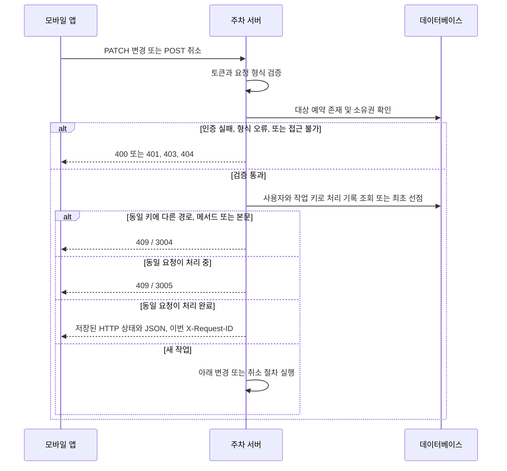
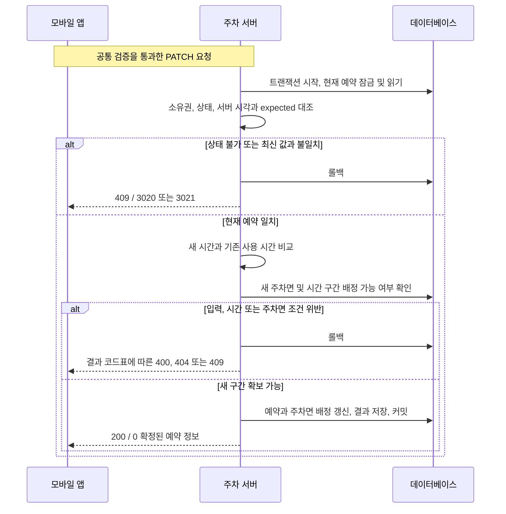
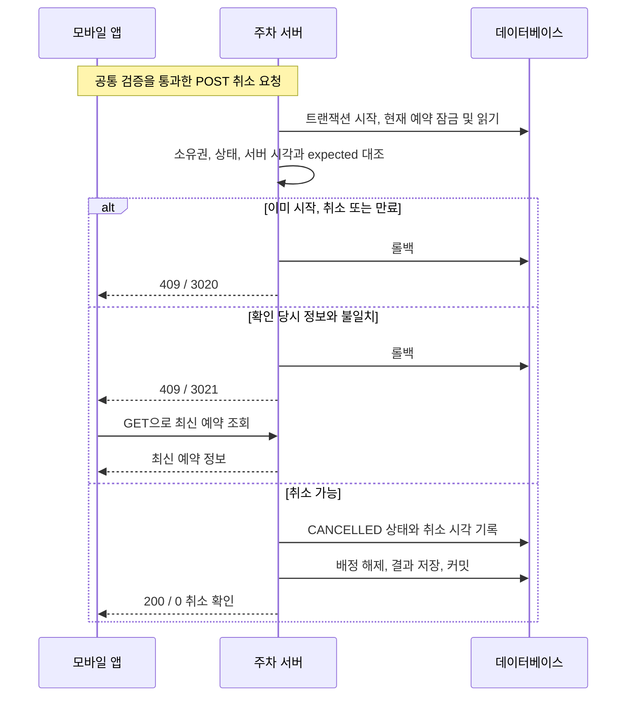
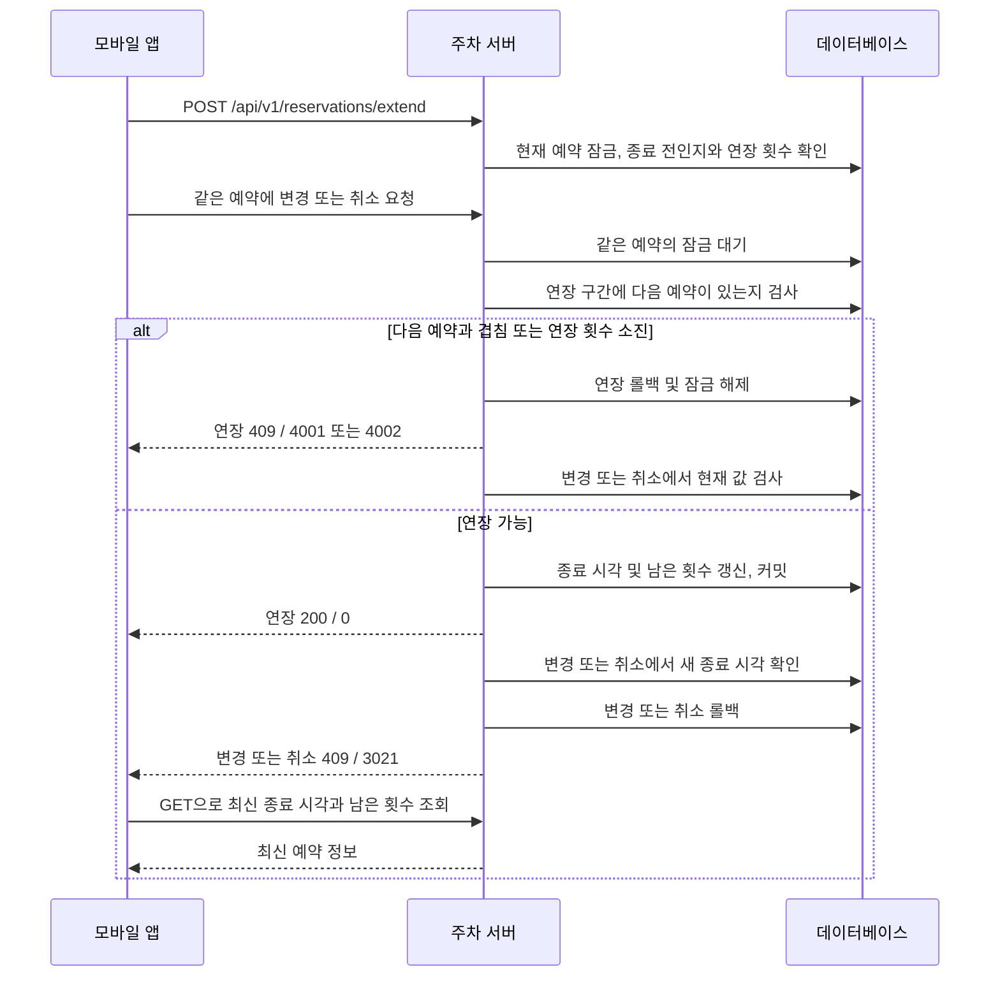

# 예약 변경·취소 시퀀스 다이어그램

담당: 최지한 · 참여자: 모바일 앱, 주차 서버, 데이터베이스

요청·응답 필드는 [메시지 정의표](메시지_정의표.md), HTTP 상태와 앱 대응은 [결과 코드표](결과_코드표.md)를 참조한다.

## 1. 공통 인증과 재전송

앱은 사용자가 변경·취소를 확인하면 작업 키를 한 번 생성한다. 버튼을 다시 누르거나 응답이 유실돼 재전송할 때는 동일 본문과 `Idempotency-Key`를 유지하고 `X-Request-ID`만 새로 생성한다.

- 결과 저장 후 응답이 끊긴 경우에도 재전송은 원래 HTTP 상태와 본문을 반환한다. `X-Request-ID`는 이번 전송의 값을 사용한다. 따라서 성공한 취소를 재전송하면 취소 불가 응답 대신 기존 성공 응답을 받는다.
- 서버는 사용자와 작업 키 조합을 유일하게 유지하고, 메서드·경로·본문 바이트로 동일 요청인지 판별한다. 앱은 재전송에 사용할 요청 본문을 보관한다.
- 성공 응답에 필요한 결과와 예약 갱신은 같은 트랜잭션에서 커밋한다. 도메인 검증 실패는 예약 상태를 바꾸지 않고 최종 결과를 남긴다. 일시 오류로 커밋하지 못한 경우 서버는 롤백한 뒤 해당 키의 처리를 재개할 수 있게 한다. 커밋 여부가 불분명하면 결과 기록으로 먼저 확인한다. 작업 키와 결과의 보존 기간은 팀 통합 시 확정한다.

## 2. 예약 변경

기존 배정을 포함해 하나의 트랜잭션에서 교체한다. 새 구간은 자기 예약을 제외한 유효 배정과 비교하며, 확인과 반영 사이에 다른 요청이 같은 주차면·시간대를 선점할 수 없도록 DB 제약이나 잠금으로 보호한다. 충돌이 확인되면 기존 배정을 유지하고 `409 / 3003`을 반환한다.

## 3. 예약 취소

## 4. A-5 연장과 동시에 들어온 경우

위 예시는 변경·취소가 서버 기준으로 시작 전에 가능한 예약에서 연장이 먼저 잠금을 획득한 경우다. 취소가 먼저 커밋되면 연장은 취소 상태를 읽고 거절한다. 변경이 먼저 커밋되면 연장은 최신 주차면·시각에서 조건을 다시 검사한다. 예약 생성도 같은 주차면·시간 구간의 중복 방지 규칙을 공유한다.

[A-5 연장 명세](../박준오/메시지%20정의표.md) · [예약 조회 명세](../장성준/예약조회_메시지정의표.md)
